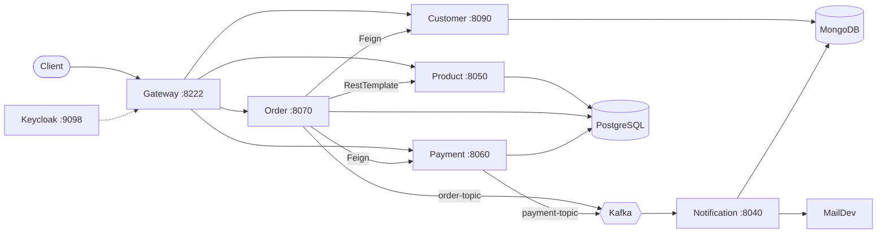

# ShopFlow

E-commerce backend split into Spring Boot microservices: customers, products, orders, payments and notifications. Each service owns its data, registers with Eureka, reads its config from a Config Server, and sits behind one API gateway. Orders call other services over HTTP; confirmations go out through Kafka.


## Architecture



Config Server (8888), Eureka (8761) and Zipkin (9411) run alongside and are used by every service.

### Placing an order

`POST /api/v1/orders` goes through these steps in `OrderService`:

1. Check the customer exists (customer service, Feign).
2. Purchase the products, which checks and decrements stock (product service).
3. Save the order and its order lines.
4. Create the payment (payment service, Feign). Payment publishes to `payment-topic`.
5. Publish an `OrderConfirmation` to `order-topic`.

The notification service consumes both topics, stores a record in MongoDB and sends an HTML email (visible in MailDev during development). Email delivery is off the request path, so a slow SMTP server doesn't slow down checkout.

## Services

| Service | Port | Storage | Does |
|---|---|---|---|
| config-server | 8888 | files in `configurations/` | Serves config to every service |
| discovery | 8761 | | Eureka registry |
| gateway | 8222 | | Routes `/api/v1/**` to services, OAuth2 resource server |
| customer | 8090 | MongoDB | Customers and addresses |
| product | 8050 | PostgreSQL, Flyway | Catalog, categories, stock |
| order | 8070 | PostgreSQL | Orders and order lines |
| payment | 8060 | PostgreSQL | Payments |
| notification | 8040 | MongoDB | Kafka consumer, emails |

## Design choices

- **Database per service.** Customer data is document-shaped, so it lives in MongoDB. Orders, payments and stock need transactions, so they live in PostgreSQL, with one database each on a single local Postgres instance.
- **Gateway routes by service name** (`lb://ORDER-SERVICE`), so starting a second instance of a service is enough for traffic to spread across both.
- **Kafka for notifications only.** The core order steps stay synchronous to keep the flow easy to follow. Sending confirmations is the part that doesn't need to be in the request.
- **Kafka runs in KRaft mode**, so there's no ZooKeeper container to manage.
- **Flyway for the product schema** with `ddl-auto: validate`, so Hibernate can't drift from the migrations. Order and payment still use `ddl-auto: update`.

## Known limitations

These are deliberate gaps for now, not oversights:

- No compensation if a later step fails. If payment creation fails after stock was decremented, the stock isn't restored. An outbox or saga would fix this.
- No retries or circuit breakers on inter-service calls yet.
- Business services run from Maven, not containers. Only the infrastructure is in `docker-compose.yml`.
- Keycloak realm setup is manual.
- Credentials in the config files are local development values.

## Running it locally

Requires Java 17, Docker, and Maven (each service has a `./mvnw` wrapper).

Start the infrastructure (PostgreSQL, MongoDB, Kafka, Keycloak, Zipkin, MailDev):

```bash
docker compose up -d
```

PostgreSQL is on port 5433 so it doesn't clash with a local install. On a fresh volume, `docker/postgres/init-databases.sql` creates the `product`, `payment` and `order` databases. If your volume predates that script and the data is disposable, run `docker compose down -v` and start again.

Start config-server first, then discovery, then gateway, each in its own terminal:

```bash
cd services/config-server && ./mvnw spring-boot:run
cd services/discovery && ./mvnw spring-boot:run
cd services/gateway && ./mvnw spring-boot:run
```

Then start the rest in any order: `customer`, `product`, `payment`, `order`, `notification`.

For auth, open Keycloak at http://localhost:9098 (admin/admin), create a realm named `ecommerce-ms` and a client, get a token, and send it as `Authorization: Bearer <token>`.

If a service misbehaves, check `docker compose ps`, then Eureka at http://localhost:8761, then the config it received at `http://localhost:8888/<service-name>/default`.

Other local UIs: Zipkin http://localhost:9411, MailDev http://localhost:1080, Mongo Express http://localhost:8083.

## API

Everything goes through the gateway at `http://localhost:8222`.

| Resource | Endpoints |
|---|---|
| `/api/v1/customers` | `POST`, `PUT`, `GET`, `GET /{id}`, `GET /exists/{id}`, `DELETE /{id}` |
| `/api/v1/products` | `POST`, `GET`, `GET /{id}`, `POST /purchase` |
| `/api/v1/orders` | `POST`, `GET`, `GET /{id}` |
| `/api/v1/order-lines` | `GET /order/{orderId}` |
| `/api/v1/payments` | `POST` |

## Tests

Each service has unit tests for request validation and for the DTOs it shares with other services. These catch a field rename in one service breaking another.

```bash
cd services/order && ./mvnw test
```

`scripts/test-api-gateway.sh` runs a full flow against the running system: customer CRUD, product creation and purchase, payment, order creation, stock changes, and checks that the notification was stored. It creates its own data and deletes only what it created.

```bash
./scripts/test-api-gateway.sh
./scripts/test-api-gateway.sh --help   # token, remote gateway, timeouts, verbose
```

## Next

- Outbox pattern for order and payment events
- Resilience4j on Feign and RestTemplate calls
- Dockerfiles for every service and a single `docker compose up`
- Keycloak realm export so auth works out of the box
- GitHub Actions running the tests
