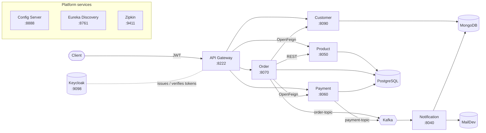
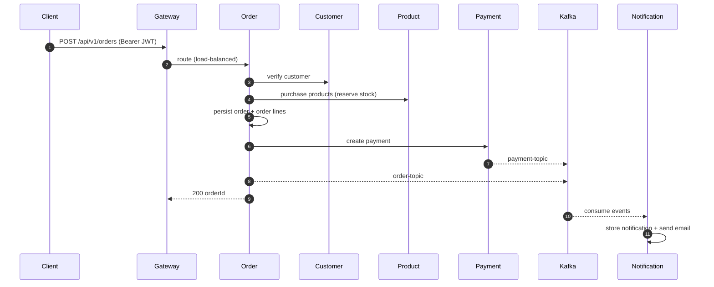

<div align="center">

# 🛒 ShopFlow

**A cloud-native e-commerce backend built as independently deployable, horizontally scalable microservices.**


</div>

---

## Overview

ShopFlow handles the core of an online store: customers, product catalog and inventory, orders, payments, and email notifications. Each capability is its own Spring Boot service with its own database, so every part of the system can be **deployed, scaled, and evolved independently**.

Services discover each other through **Eureka**, pull configuration from a central **Config Server**, sit behind a single **API Gateway** secured with **Keycloak (OAuth2 / JWT)**, and communicate both **synchronously** (REST / OpenFeign) and **asynchronously** (Apache Kafka events). Every request is traced end to end with **Zipkin**.

### Highlights

- **Database per service.** PostgreSQL for transactional data, MongoDB for documents. No shared schemas.
- **Event-driven notifications.** Order and payment confirmations are published to Kafka and consumed without blocking the checkout path.
- **Client-side load balancing.** The gateway routes to `lb://SERVICE-NAME`, so adding instances scales a service with no config change.
- **Centralized configuration.** One Config Server feeds every service, so environments change in one place.
- **Edge security.** The gateway validates JWTs issued by Keycloak before traffic reaches any service.
- **Observability.** Distributed tracing across services with Micrometer and Zipkin.
- **Schema migrations.** Flyway manages the product catalog schema.
- **Tested contracts.** Validation and inter-service contract tests, plus an end-to-end gateway test script.

---

## Architecture



### Order flow



---

## Services

| Service | Port | Storage | Responsibility |
|---|---|---|---|
| `config-server` | 8888 | — | Central configuration for all services |
| `discovery` | 8761 | — | Eureka service registry |
| `gateway` | 8222 | — | Single entry point, routing, JWT validation |
| `customer` | 8090 | MongoDB | Customer profiles and addresses |
| `product` | 8050 | PostgreSQL + Flyway | Catalog, categories, stock and purchasing |
| `order` | 8070 | PostgreSQL | Order orchestration and order lines |
| `payment` | 8060 | PostgreSQL | Payment processing, publishes payment events |
| `notification` | 8040 | MongoDB | Consumes Kafka events, sends emails |

### Infrastructure (Docker Compose)

| Component | Port | Purpose |
|---|---|---|
| PostgreSQL | 5433 | Product, order and payment databases |
| MongoDB / Mongo Express | 27017 / 8083 | Customer and notification data, plus admin UI |
| Kafka (KRaft, no ZooKeeper) | 9092 | Event streaming |
| Keycloak | 9098 | Identity provider (OAuth2 / OIDC) |
| Zipkin | 9411 | Distributed tracing UI |
| MailDev | 1080 / 1025 | Email inbox UI / SMTP |

---

## Tech stack

**Backend:** Java 17, Spring Boot 4, Spring Data JPA, Spring Data MongoDB, Spring Kafka, Bean Validation, Lombok
**Spring Cloud:** Gateway, Netflix Eureka, Config Server, OpenFeign, LoadBalancer
**Security:** Spring Security OAuth2 Resource Server, Keycloak
**Data:** PostgreSQL, MongoDB, Flyway
**Messaging:** Apache Kafka (KRaft mode)
**Observability:** Micrometer Tracing, Zipkin
**Tooling:** Docker Compose, Maven, JUnit

---

## Getting started

### Prerequisites

- Java 17+
- Maven 3.9+
- Docker and Docker Compose

### 1. Start the infrastructure

```bash
docker compose up -d
```

A fresh PostgreSQL volume creates the `product`, `payment` and `order` databases automatically (`docker/postgres/init-databases.sql`).

### 2. Start the services in order

```bash
# platform
cd services/config-server && ./mvnw spring-boot:run
cd services/discovery     && ./mvnw spring-boot:run
cd services/gateway       && ./mvnw spring-boot:run

# business services (any order)
cd services/customer      && ./mvnw spring-boot:run
cd services/product       && ./mvnw spring-boot:run
cd services/payment       && ./mvnw spring-boot:run
cd services/order         && ./mvnw spring-boot:run
cd services/notification  && ./mvnw spring-boot:run
```

### 3. Configure Keycloak

Open `http://localhost:9098` (admin / admin), create the realm `ecommerce-ms` and a client, then request a token and send it as `Authorization: Bearer <token>` to the gateway.

### Useful URLs

| What | URL |
|---|---|
| API Gateway | http://localhost:8222 |
| Eureka dashboard | http://localhost:8761 |
| Service config | http://localhost:8888/&lt;service-name&gt;/default |
| Zipkin | http://localhost:9411 |
| MailDev inbox | http://localhost:1080 |
| Mongo Express | http://localhost:8083 |

---

## API

All endpoints go through the gateway at `http://localhost:8222`.

| Resource | Endpoints |
|---|---|
| Customers | `POST` `PUT` `GET /api/v1/customers` · `GET /{id}` · `GET /exists/{id}` · `DELETE /{id}` |
| Products | `POST` `GET /api/v1/products` · `GET /{id}` · `POST /purchase` |
| Orders | `POST` `GET /api/v1/orders` · `GET /{id}` |
| Order lines | `GET /api/v1/order-lines/order/{orderId}` |
| Payments | `POST /api/v1/payments` |

---

## Testing

Unit and contract tests per service:

```bash
cd services/<service> && ./mvnw test
```

End-to-end check through the gateway. It covers customer CRUD, product purchase, payment, order creation, inventory changes and Kafka notification persistence, and cleans up the records it creates:

```bash
./scripts/test-api-gateway.sh            # run everything
./scripts/test-api-gateway.sh --help     # auth token, remote gateway, timeouts, verbose
```

---

## Scaling notes

- **Horizontal scale:** run extra instances of any business service. They register in Eureka and the gateway balances across them.
- **Independent data:** each service owns its database, so storage scales and migrates per service.
- **Async decoupling:** Kafka absorbs notification load. Slow email delivery never slows checkout, and consumers scale through consumer groups.
- **Stateless services:** authentication is JWT-based, so no session state ties a client to an instance.

## Roadmap

- [ ] Containerize every service and add a full `docker compose` profile
- [ ] Kubernetes manifests / Helm chart
- [ ] Resilience4j circuit breakers and retries on inter-service calls
- [ ] Saga / outbox pattern for order and payment consistency
- [ ] CI pipeline with GitHub Actions

---

<div align="center">

Built by **Ayoub ESSARGHINI**

</div>
